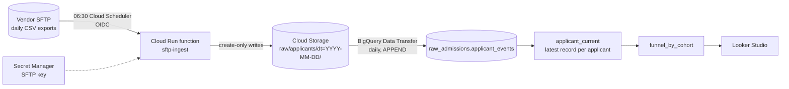

# event-driven-gcs-ingest

A small, production-shaped pipeline for the most common data integration in marketing operations: a platform drops daily export files on an SFTP server, and someone needs them in BigQuery and on a dashboard every morning.



The sample domain is a graduate admissions funnel (inquiry → application started → submitted → admitted → deposited) at a fictional university. All data is synthetic, from `generator/generate_funnel.py`.

## Decisions worth noting

**Idempotent by design.** The GCS path is derived only from the file name, a file already landed at the same size is skipped, and uploads use `if_generation_match=0` (create-only) so two overlapping runs can't double-write. Re-running the job is always safe.

**Corrections are flagged, not overwritten.** If the vendor re-sends a file with the same name and a different size, the function logs it as a size mismatch and leaves the original. Silently replacing raw history is how numbers change under a dashboard with no explanation.

**Security defaults.**
- The function rejects unauthenticated calls; only the scheduler's service account can invoke it.
- The function's own service account can create objects in one bucket and read one secret. Nothing else.
- The SFTP host key is pinned (`RejectPolicy`), not auto-accepted.
- The key lives in Secret Manager, never in env vars or the repo.
- The bucket has public access prevention and a lifecycle rule on raw files.

**Why a function plus Data Transfer, not one big job.** Each piece does one thing and fails independently. If the SFTP pull fails, yesterday's data is still in BigQuery and the next run catches up. Loading is a managed, scheduled transfer with its own run history, and no custom code to maintain.

**CDC-style exports need a dedupe view.** Each daily file holds every record that changed that day, so an applicant appears once per stage change. `sql/01_applicant_current.sql` keeps the latest row per applicant.

**The funnel counts "reached stage," not "current stage."** `sql/02` counts non-null stage dates, so everyone admitted also counts as started and submitted. Counting `current_stage` instead is the most common way admissions funnels end up non-monotonic. `sql/03_quality_checks.sql` asserts nesting, date order, and monotonic cohort counts.

## Run locally (no GCP needed)

```bash
pip install -r requirements-dev.txt
pytest -q
python generator/generate_funnel.py --out data/sftp_drop
python scripts/local_demo.py     # folder-to-folder with the real transfer logic
python scripts/local_demo.py     # second run: everything skipped
```

## Deploy

`infra/deploy.sh` creates the bucket, service accounts, secret, function, scheduler job, datasets, transfer config, and views. Fill in the variables at the top, add your SFTP key to Secret Manager, and read each step before running it.

## Layout

```
function/      Cloud Run function (main.py) + pure, tested transfer logic (ingest.py)
generator/     synthetic admissions funnel exports
sql/           dedupe view, cohort funnel view, data quality checks
infra/         deploy script, BigQuery schema
scripts/       local folder-to-folder demo
tests/         idempotency, correction handling, funnel invariants
```
